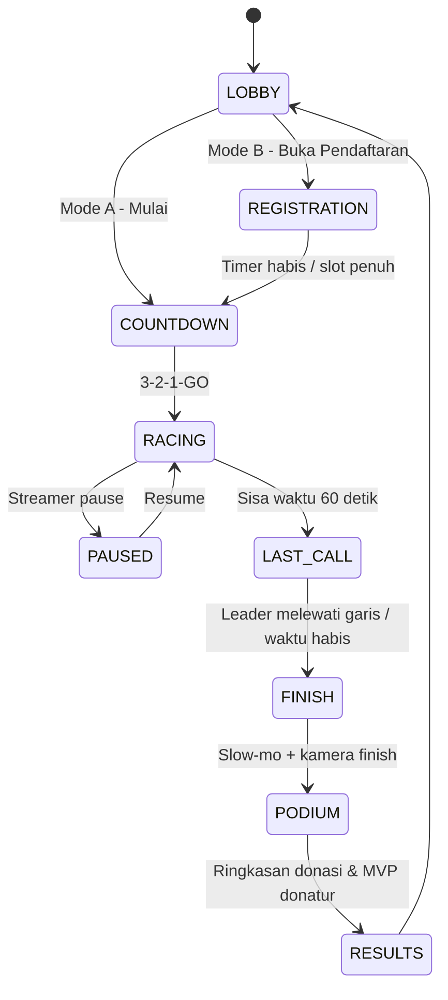
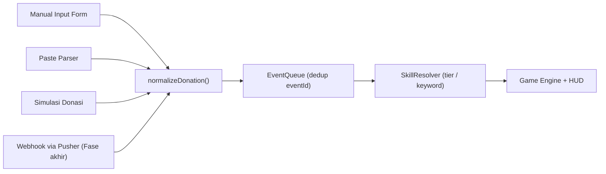

# StreamKart 3D: Multi-Tenant Interactive Donation-Driven Racing Game
**Comprehensive System Architecture, Technical Design & Implementation Plan** — *Revisi 2*

---

## 1. Executive Summary

**StreamKart 3D** adalah platform web balapan 3D arcade (*Mario Kart / CTR style*) berbasis **Three.js** yang dirancang sebagai sarana interaktif gamifikasi donasi untuk para YouTuber dan live streamer.

### Karakteristik Kunci
* **Zero Database & 100% Free Tier:** Seluruh status permainan berjalan di *in-memory runtime* browser streamer dan penyimpanan konfigurasi lokal (`localStorage`). Validasi keamanan dilakukan secara *stateless* (HMAC), sehingga tetap tanpa database.
* **Multi-Tenant (Multi-Streamer Ready):** Sistem *Dynamic Room ID & Secret Token* memungkinkan puluhan streamer menggunakan satu aplikasi yang sama secara bersamaan tanpa risiko donasi tertukar.
* **Time-Boxed Voting Race:** Streamer menentukan **durasi voting (1–60 menit)** sebelum mulai. Jumlah lap dan kecepatan balapan **menyesuaikan otomatis** agar balapan selesai tepat saat waktu voting habis.
* **Single-Screen Share Layout:** Antarmuka menggabungkan kanvas visual 3D dan panel admin *collapsible* dalam satu jendela browser, dengan opsi **Pop-out Admin** agar panel kontrol tidak pernah terlihat penonton.
* **Hybrid Trigger System:** Otomatisasi penerimaan donasi melalui webhook (Saweria, Tako, Bagi-Bagi) via WebSocket relay, dilengkapi panel kontrol manual untuk koreksi instan.
* **Broadcast-Quality Visual:** Pseudo-physics di atas spline, kamera *director* ala siaran TV, post-processing (bloom, speed lines), dan skill dengan VFX/SFX penuh.

---

## 2. Multi-Tenant Architecture & Room Isolation

Untuk memastikan donasi dari penonton Streamer A tidak masuk ke sesi permainan Streamer B, sistem menggunakan pemisahan berbasis **Room ID** dan **Secret Token** yang divalidasi di server tanpa database.

### 2.1. Topologi Data Multi-Tenant

```text
[ Saweria / Tako / Bagi-Bagi ]
               │
               │ HTTP POST /api/webhook?provider=saweria&room={roomId}&secret={streamerSecret}
               ▼
[ Vercel Serverless Function (/api/webhook.js) ]
               │
               │ 1. Validasi format Room ID
               │ 2. Validasi Secret: HMAC(MASTER_KEY, roomId) === secret   (stateless)
               │ 3. (Opsional) Verifikasi signature bawaan provider
               │ 4. Normalisasi Payload per provider (Nama, Nominal, Pesan, ProviderEventId)
               │ 5. Forward ke Private Channel (TANPA menyertakan secret)
               ▼
   [ Pusher Channels — Private Channel ]
               │
               ├── private-streamkart-{roomId_A} ──► [ Browser Streamer A ] (auth via /api/pusher-auth)
               │
               └── private-streamkart-{roomId_B} ──► [ Browser Streamer B ]
```

### 2.2. Mekanisme Alur Kerja Multi-Streamer
1. **Penerbitan Room:** Saat streamer membuka aplikasi pertama kali, frontend memanggil `POST /api/create-room`. Server membuat:
   * `Room ID` (contoh: `room_indra99_x7k2`) — acak, sulit ditebak.
   * `Secret Token` = `HMAC_SHA256(MASTER_KEY, roomId)` dipotong 24 karakter.
   Kedua nilai disimpan di `localStorage` streamer. Server **tidak menyimpan apa pun**; ia cukup menghitung ulang HMAC saat validasi.
2. **Setup Webhook Satu Kali:** Streamer menyalin URL webhook pribadi dari panel dashboard:
   ```text
   https://streamkart.vercel.app/api/webhook?provider=saweria&room=room_indra99_x7k2&secret=3f9a...
   ```
   URL ini ditempelkan ke dashboard Saweria/Tako/Bagi-Bagi streamer.
3. **Isolasi Koneksi:** Browser streamer subscribe ke **private channel** `private-streamkart-{roomId}`. Pusher meminta otorisasi ke `/api/pusher-auth`, yang hanya mengizinkan jika `secret` cocok. Orang lain tidak bisa ikut subscribe atau mengintip event.
4. **Reset Secret:** Jika URL bocor, streamer menekan **"Generate Room Baru"** (room + secret baru) lalu memperbarui URL di dashboard provider.

### 2.3. Catatan Free Tier & Batasan
* **Pusher Sandbox:** 200.000 pesan/hari dan **100 koneksi bersamaan**. Cukup untuk tahap awal; perlu upgrade jika pengguna bertambah.
* **Vercel Hobby:** hanya untuk penggunaan **non-komersial**. Jika aplikasi dimonetisasi, wajib upgrade ke Pro.
* **Donasi saat browser streamer tertutup akan hilang** (Pusher tidak menyimpan pesan). Ini *known limitation*; opsi lanjutan: buffer di Upstash Redis free tier.

---

## 3. Game Modes & Gameplay Mechanics

### 3.1. Mode Permainan (Pre-Race Configuration)

#### Mode A: Option Voting Race (Keputusan Audiens)
* **Kasus Penggunaan:** Streamer meminta penonton memilih opsi (contoh: *Pilih Game Selanjutnya: [1] Elden Ring, [2] GTA V, [3] Roblox*).
* **Peserta:** Ditetapkan manual oleh streamer di sidebar admin (nama opsi, warna mobil, maksimal 12 opsi).
* **Interaksi Penonton:** Donatur menyertakan kode opsi dalam pesan donasi (misal `#1 gas pol`, `#2 !misil`).
* **Penentuan Hasil:** Opsi pemenang adalah mobil yang pertama kali menyelesaikan seluruh lap. Karena lap disesuaikan dengan durasi voting, finish terjadi tepat saat waktu voting habis (lihat §4).

#### Mode B: Donator Battle Royale (Adu Gengsi Donatur)
* **Kasus Penggunaan:** Menghibur penonton setia dan memicu kompetisi donasi antar penonton.
* **Peserta:** Diisi lewat fase **REGISTRATION** (default 60 detik, dapat diatur). Donasi ≥ nominal minimal (misal Rp 10.000) mendaftarkan donatur sebagai pembalap. Maksimal 12 mobil; jika penuh, prioritas ke nominal terbesar.
* **Interaksi Penonton:** Donasi baru dapat memberikan buff ke mobil jagoan atau menembakkan item serangan ke mobil kompetitor.

### 3.2. Race State Machine



* **PAUSED:** timer voting dan simulasi berhenti; donasi yang masuk ditampung di antrean dan dieksekusi setelah resume.
* **LAST_CALL:** banner "⏰ 60 DETIK TERAKHIR!", musik lebih intens, kamera lebih sering ke rombongan depan.

### 3.3. Format Perintah Donasi
* Grammar: `#<nomor> [!<skill>] [pesan bebas]` — contoh: `#2 !misil semangat`, `#3 !shield`, `#1 gas`.
* Jika `!skill` tidak disebut, skill ditentukan otomatis dari **tier nominal** (§5.2).
* Alias kata kunci dapat dikonfigurasi (misal `misil | missile | roket`).
* Donasi tanpa `#nomor` masuk ke **Unassigned Donations** (§11).

### 3.4. Keseimbangan Balapan (Balance Rules)
* **Kecepatan dasar:** sama untuk semua mobil, ditambah *noise* kecil (±3%) agar balapan tanpa donasi tetap seru dan tidak bisa ditebak.
* **Rubber-banding:** mobil di belakang leader mendapat bonus kecepatan kecil (0–8%, intensitas diatur streamer: Off / Low / Medium).
* **Stun Immunity:** setelah terkena efek *crowd control* (spin-out, stun, freeze), mobil kebal CC selama **2 detik**. Ini mencegah satu donatur besar mengunci lawan terus-menerus.
* **Batas stack buff:** maksimal total bonus kecepatan +120%; durasi buff yang sama diperpanjang, bukan dikalikan.
* **Opsi "Pure Vote" (Mode A):** setiap Rp 1.000 donasi juga menambah *progress* kecil secara permanen ke mobil target, sehingga total donasi tetap menjadi faktor dominan pemenang voting.

---

## 4. Time-Boxed Race: Durasi Voting & Adaptive Lap System

Sebelum balapan dimulai, streamer menentukan **durasi voting** antara **1 menit hingga maksimal 60 menit**. Sistem lalu menghitung jumlah lap dan mengatur kecepatan agar mobil pertama finish **tepat saat waktu habis**.

### 4.1. Konfigurasi di Panel Admin
* Input durasi: slider/number `1–60 menit` + tombol preset **[3] [5] [10] [15] [30] [60]**.
* Pratinjau otomatis: *"Durasi 15 menit → Lintasan Circuit, 15 lap (~60 detik/lap)"*.
* Streamer dapat mengunci jumlah lap secara manual (opsional); jika dikunci, sistem hanya mengatur kecepatan.

### 4.2. Penentuan Jumlah Lap
Setiap lintasan memiliki **reference lap time** $L_{ref}$ (waktu tempuh 1 lap pada kecepatan dasar). Lintasan dipilih berdasarkan durasi agar lap tidak terlalu banyak/sedikit:

| Durasi Voting | Lintasan Disarankan | $L_{ref}$ | Jumlah Lap |
| :--- | :--- | :--- | :--- |
| 1–5 menit | Sprint (pendek) | ±30 detik | 2–10 |
| 6–20 menit | Circuit (sedang) | ±60 detik | 6–20 |
| 21–60 menit | Grand Prix (panjang) | ±90 detik | 14–40 |

$$
\text{Laps} = \max\left(1,\ \text{round}\left(\frac{T_{voting}}{L_{ref}}\right)\right)
$$

### 4.3. Pacing Controller (Kunci Agar Finish Tepat Waktu)
Donasi (boost, serangan) mengubah kecepatan sehingga waktu finish bisa bergeser. Karena itu, setiap 0.5 detik sistem menghitung ulang **pengali kecepatan global** $m$ yang diterapkan **sama rata ke semua mobil** (selisih relatif antar mobil akibat donasi tetap terjaga):

$$
m_{target} = \frac{D_{leader}}{v_0 \cdot R}
$$

* $D_{leader}$ = sisa jarak leader hingga finish (dalam satuan lintasan)
* $v_0$ = kecepatan dasar
* $R$ = sisa waktu voting (detik)

Nilai $m$ dihaluskan (`m += (m_target − m) · 0.1`) dan dibatasi `0.75 ≤ m ≤ 1.30` agar perubahan tidak terasa janggal secara visual.

### 4.4. Aturan Batas Waktu (Hard Deadline)
* Jika waktu habis sebelum leader menyentuh garis finish (kasus langka), balapan berakhir dengan **Photo Finish**: urutan saat itu menjadi hasil final, dengan kamera slow-mo dan freeze frame.
* Jika leader finish lebih cepat dari waktu (karena batas $m$), timer langsung berhenti dan masuk FINISH.
* Donasi hanya dihitung selama `RACING` dan `LAST_CALL`. Donasi setelah FINISH dicatat di layar hasil sebagai "donasi terlambat".

### 4.5. Konten untuk Balapan Panjang (20–60 Menit)
Agar balapan 1 jam tidak membosankan:
* **Checkpoint Event** setiap 10 menit: "HALFTIME STANDINGS", bonus round (item box legendary selama 30 detik).
* **Siklus siang–malam & cuaca** yang berganti bertahap (siang → senja → malam neon → hujan) sehingga visual terus berubah.
* **Rotasi kamera** lebih variatif (trackside, drone, onboard) saat tidak ada aksi.
* **Snapshot state** ke `localStorage` setiap 5 detik untuk pemulihan jika browser ter-refresh (§11).

### 4.6. Timer Berbasis Wall-Clock
Timer voting memakai `performance.now()`/`Date.now()`, bukan jumlah frame. Jika tab sempat tidak aktif dan `requestAnimationFrame` melambat, simulasi mengejar dengan *fixed timestep* (maksimal 5 detik catch-up), sehingga hasil tetap konsisten dengan sisa waktu sebenarnya.

---

## 5. Skill / Item System

### 5.1. Prinsip "Juice" — Setiap Skill Wajib Punya 5 Lapisan
1. **Telegraph:** UI callout besar, misal *"🎯 BUDI menembakkan MISIL ke #2 GTA V!"*
2. **VFX:** partikel, trail, ledakan (three.quarks + shader).
3. **SFX:** suara peluncuran + suara saat mengenai target.
4. **Kamera:** action cut ke target, screen shake, atau slow-mo.
5. **Reaksi Target:** animasi spin/terpental/mengecil + emoji di name tag (😵, 🥶, 💥).

### 5.2. Spesifikasi Mekanik Skill / Item

Tier nominal di bawah adalah **default** dan dapat diubah streamer sesuai ukuran channel.

| Rarity | Nama Skill | Tipe | Target | Tier Nominal Standar | Perilaku Logika | Visual Kunci |
| :--- | :--- | :--- | :--- | :--- | :--- | :--- |
| ⚪ Common | **Mini Boost** | Buff | Mobil Pilihan | Rp 5.000 – 9.999 | Kecepatan $+35\%$ selama 2.0 detik. | Api biru kecil, speed lines |
| ⚪ Common | **Banana Trap** | Trap | Belakang Mobil Pilihan | Rp 10.000 – 14.999 | Rintangan di lintasan. Mobil lain yang melintas di radius $r = 1.2\text{ unit}$ *spin-out* 1.5 detik. | Pisang berputar, bintang di kepala |
| 🟢 Uncommon | **Oil Slick** | Trap | Belakang Mobil Pilihan | Rp 15.000 – 24.999 | Mobil yang melintas tergelincir zig-zag, kecepatan $-40\%$ selama 2 detik. | Genangan hitam mengilap, cipratan |
| 🟢 Uncommon | **Guardian Shield** | Defense | Mobil Pilihan | Keyword `!shield` (min Rp 15.000) | Kebal semua serangan 6.0 detik. **Memantulkan misil** ke penembak. | Gelembung hex bercahaya (fresnel shader) |
| 🔵 Rare | **Nitro NOS** | Buff | Mobil Pilihan | Rp 25.000 – 49.999 | Kecepatan $+85\%$ selama 3.5 detik. | Api ungu-biru, bloom, FOV melebar |
| 🔵 Rare | **Homing Missile** | Attack | 1 Peringkat di Depan | Rp 50.000 – 74.999 | Proyektil mengikuti kurva. Target terpental vertikal $+2\text{ unit}$, kecepatan $= 0$ selama 2.5 detik. | Trail asap, ledakan, debris |
| 🔵 Rare | **Freeze Ray** | Attack | Mobil Pilihan (lawan) | Keyword `!freeze` (min Rp 50.000) | Target membeku 2.0 detik. Menetralkan buff aktif. | Kristal es membungkus mobil lalu pecah |
| 🟣 Epic | **Magnet Beam** | Utility | Mobil Pilihan | Rp 75.000 – 99.999 | Menarik mobil pilihan ke posisi tepat di belakang mobil di depannya (maks 15% lap). | Sinar biru menyambung, distorsi |
| 🟣 Epic | **Giant Mode** | Buff | Mobil Pilihan | Keyword `!giant` (min Rp 75.000) | Mobil membesar $2\times$ selama 5 detik, kebal pisang/oli, lawan yang ditabrak terpental. | Scale-up dramatis, lantai berguncang |
| 🟡 Legendary | **Thunder Strike** | Ultimate | Semua Lawan | Rp 100.000 – 199.999 | Ukuran semua kompetitor $-50\%$ dan kecepatan $-50\%$ selama 4.0 detik. | Langit gelap, petir, layar flash putih |
| 🟡 Legendary | **Sultan Strike** | Ultimate | Peringkat 1 | Keyword `!sultan` (min Rp 150.000) | Misil terbang tinggi lalu menukik ke leader. Stun 3 detik, ledakan area kecil. | Bayangan target di jalan, ledakan besar |
| 🔴 Mythic | **Position Swap** | Ultimate | 1 Peringkat di Depan | Rp 200.000 – 499.999 | Bertukar posisi dengan mobil di depannya. | Efek portal/teleport ungu |
| 🔴 Mythic | **Meteor Shower** | Ultimate | Semua Lawan (acak) | ≥ Rp 500.000 | Hujan meteor 5 detik, setiap mobil lawan berpeluang kena stun 1.5 detik. | Kamera drone, langit merah, bayangan meteor |

### 5.3. Interaksi Antar-Skill
* Shield memantulkan Homing Missile dan Sultan Strike ke mobil penembak (jika di Mode B) atau ke mobil di belakang target.
* Freeze menetralkan Nitro/Mini Boost yang sedang aktif.
* Giant Mode kebal terhadap Banana dan Oil Slick.
* Stun Immunity (2 detik) berlaku untuk semua efek CC (§3.4).

### 5.4. Mekanik Penunjang Hype
* **Hype Meter:** total donasi dalam 60 detik terakhir mengisi meter di HUD. Saat penuh → **CHAOS MODE** 15 detik: semua item box bernilai Legendary, musik berganti, lintasan bernuansa merah.
* **Support Combo:** 3+ donasi ke mobil yang sama dalam 10 detik → banner "SUPPORT COMBO ×3" + boost bonus kecil.
* **MVP Donatur:** donatur dengan total terbesar ditampilkan di layar RESULTS beserta skill favoritnya.
* **Item Box di Lintasan:** mobil yang melewati item box mendapat skill Common acak, sehingga ada aksi walaupun donasi sedang sepi.

---

## 6. Visual Design: Rasa Game Racing Sungguhan

> Mobil yang hanya bergerak di atas spline akan terlihat **seperti di atas rel**. Rasa racing datang dari **gerak sekunder, kamera, dan efek**, bukan dari detail model.

### 6.1. Art Direction
* Gaya: **stylized low-poly cartoon** (konsisten dengan aset gratis Kenney/Quaternius, ringan, dan tampil menarik dengan lighting + bloom).
* **Satu keluarga aset** saja untuk menjaga konsistensi visual.
* Palet warna cerah dan saturasi tinggi; setiap mobil memiliki warna tim yang kontras + stiker nomor besar.

### 6.2. Pseudo-Physics di Atas Spline (Tanpa Physics Engine)
* **Kecepatan & akselerasi halus:** `speed` mendekati `targetSpeed` dengan lerp, tidak melompat instan.
* **Lateral offset dinamis:** mobil berpindah posisi lateral secara halus saat menyalip, menghindari pisang, atau beriringan (pengganti 3 lajur kaku).
* **Body roll & pitch:** bodi miring ke luar saat menikung (berdasarkan kelengkungan kurva), mendongak saat boost, menunduk saat melambat.
* **Drift visual:** pada tikungan tajam, bodi berotasi 15–25°, keluar asap ban dan spark biru/oranye (ala mini-turbo).
* **Roda:** berputar sesuai kecepatan; roda depan berbelok mengikuti arah kurva; suspensi memantul halus.
* **Lompatan:** ramp di lintasan → mobil melayang dengan lintasan parabola.
* **Collision lunak:** mobil yang terlalu dekat saling mendorong ke samping (push lateral), bukan menembus.

### 6.3. Sistem Kamera "Broadcast Director"

| Kamera | Kapan Dipakai |
| :--- | :--- |
| Chase cam (belakang leader) | Default selama balapan |
| Action cut | Otomatis ke mobil yang terkena serangan selama 2–3 detik |
| Drone / orbit overview | Countdown, checkpoint event, Meteor Shower |
| Trackside cam | Kamera statis di tikungan, menyorot saat rombongan lewat |
| Onboard cam | Variasi saat balapan panjang sedang sepi aksi |
| Finish slow-mo | Saat mobil pertama melewati garis / Photo Finish |
| Podium cam | Layar selebrasi |

* Prioritas cut: Ultimate > Attack > Overtake untuk posisi 1 > rotasi idle.
* Efek kamera: FOV melebar saat boost, screen shake saat ledakan, *hit-stop* (freeze 80 ms) saat serangan kena.
* **Minimap** di pojok layar menampilkan posisi semua mobil.

### 6.4. Rendering & Post-Processing
* `ACESFilmicToneMapping`, HDRI environment (Poly Haven), soft shadow map, dan fog untuk kedalaman.
* Library `postprocessing` (pmndrs): **Bloom** selektif (nitro, misil, lampu neon), vignette, chromatic aberration ringan saat boost, color grading per tema.
* **Speed lines** (overlay shader) saat kecepatan tinggi.
* Bekas ban (decal), debu sisi jalan, confetti saat finish.
* Opsional: outline/toon shading untuk gaya kartun yang tegas.

### 6.5. Lintasan & Lingkungan
* Mesh jalan dibuat **prosedural dari kurva** (ribbon mengikuti Frenet frame): aspal, kerb merah-putih, pembatas, garis start/finish.
* Props: gerbang start/finish, tribun, pohon, item box, boost pad, ramp, serta **papan iklan berisi nama/logo channel streamer** (diatur dari panel).
* Tiga ukuran lintasan (Sprint / Circuit / Grand Prix) untuk §4.2, dengan tema: *Kota Malam Neon*, *Pantai Siang*, *Gurun / Salju*.

### 6.6. HUD Gaya Game
* Font: *Russo One* / *Bungee* / *Orbitron* (Google Fonts).
* **Timer voting besar** di atas tengah (berubah merah dan berdenyut di LAST_CALL) + indikator `LAP 7/15`.
* Countdown 3-2-1-GO dengan animasi scale/bounce (GSAP).
* Name tag 3D di atas mobil (CSS2DRenderer / `troika-three-text`) dengan warna tim.
* Banner donasi: ikon skill + nama donatur + target, warna sesuai rarity.
* Leaderboard dengan animasi naik/turun posisi; Hype Meter di sisi bawah.

---

## 7. Asset Sources & Pipeline

### 7.1. Model 3D (Mobil, Lintasan, Props)
| Sumber | Isi | Lisensi |
| :--- | :--- | :--- |
| **Kenney.nl** (kenney.nl/assets) | *Racing Kit*, *Car Kit*, *Toy Car Kit* | CC0 — rekomendasi utama |
| **Quaternius** (quaternius.com) | Paket kendaraan & lingkungan low-poly | CC0 |
| **Poly Pizza** (poly.pizza) | Mesin pencari model low-poly | Campuran CC0/CC-BY, cek per model |
| **Sketchfab** | Filter "Downloadable" | Cek lisensi; CC-BY wajib atribusi |
| **Poly Haven** (polyhaven.com) | HDRI langit, texture, model | CC0 |
| **ambientCG** (ambientcg.com) | Texture PBR | CC0 |
| AI generator (Meshy, Tripo3D) | Model custom dari teks/gambar | Free tier sering non-komersial — baca ToS |

### 7.2. VFX & Ikon Skill
* **three.quarks** — particle system untuk Three.js (api, asap, ledakan, spark) beserta editor visual.
* **Kenney Particle Pack** (CC0) — texture partikel.
* Shader custom: fresnel (shield), petir, es, portal.
* Ikon skill: **game-icons.net** (CC BY 3.0) atau dibuat dengan AI image generator.

### 7.3. Audio
| Sumber | Isi | Lisensi |
| :--- | :--- | :--- |
| Kenney Audio packs | Impact, UI, sci-fi | CC0 |
| Pixabay Sound Effects | Mesin, ledakan, nitro | Pixabay License |
| Freesound.org | Sangat lengkap | Cek per file (CC0/CC-BY) |
| Sonniss GDC Bundle | SFX profesional | Royalty-free |
| jsfxr (sfxr.me) | Generator SFX arcade | Bebas |

> **Peringatan musik latar:** gunakan hanya musik yang aman untuk stream (YouTube Audio Library / CC0) agar streamer tidak terkena Copyright Claim / Content ID. Sediakan slider volume musik & SFX terpisah serta tombol mute musik.

### 7.4. Pipeline Aset
1. Unduh → edit/gabung di **Blender**. Pisahkan material `Body` agar dapat di-*tint* per peserta.
2. Export **GLB** → kompres dengan **gltf-transform** (Meshopt/Draco untuk geometri, KTX2 untuk texture).
3. Validasi di **gltf.report**. Target total aset awal $< 8\text{ MB}$ (dimuat dengan loading screen).
4. **1 model mobil + tint warna + stiker nomor** cukup untuk 12 peserta (variasi 2–3 model opsional).
5. Catat seluruh sumber & lisensi di **`CREDITS.md`** dan tampilkan di menu "Credits".

---

## 8. Technical Architecture (Serverless & Client-Centric)

### 8.1. Komponen Teknologi
* **Visual Engine:** `Three.js` (WebGL; WebGPU opsional)
  * Lintasan: `THREE.CatmullRomCurve3` dengan *Frenet Frames* untuk orientasi rotasi otomatis + road mesh prosedural.
  * Model Aset: Low-poly glTF/GLB terkompresi (§7.4).
* **Library Pendukung:** `postprocessing` (pmndrs), `three.quarks` (partikel), `gsap` (animasi UI), `howler.js` (audio), `troika-three-text` (teks 3D), `tweakpane` + `stats.js` (debug).
* **Antarmuka UI:** HTML5 + Tailwind CSS (di atas canvas 3D).
* **Audio System:** Howler.js di atas Web Audio API (mesin, nitro, tabrakan, countdown, musik).
* **Admin Sync:** `BroadcastChannel` API untuk sinkronisasi window game ↔ window Pop-out Admin.
* **Serverless Relay Backend:** Vercel Serverless Function (Node.js runtime).
* **Realtime WebSocket Provider:** Pusher Channels (Private Channel) atau Supabase Realtime Broadcast.

### 8.2. Skema Backend Serverless

#### `api/_lib/room.js`
```javascript
import crypto from "node:crypto";

export const ROOM_REGEX = /^room_[a-z0-9_]{4,40}$/;

export function deriveSecret(roomId) {
  return crypto
    .createHmac("sha256", process.env.MASTER_KEY)
    .update(roomId)
    .digest("hex")
    .slice(0, 24);
}

export function isValidSecret(roomId, secret) {
  if (!ROOM_REGEX.test(roomId) || typeof secret !== "string") return false;
  const expected = Buffer.from(deriveSecret(roomId));
  const provided = Buffer.from(secret);
  return expected.length === provided.length && crypto.timingSafeEqual(expected, provided);
}
```

#### `api/webhook.js`
```javascript
import Pusher from "pusher";
import { isValidSecret } from "./_lib/room.js";

const pusher = new Pusher({
  appId: process.env.PUSHER_APP_ID,
  key: process.env.PUSHER_KEY,
  secret: process.env.PUSHER_SECRET,
  cluster: process.env.PUSHER_CLUSTER || "ap1",
  useTLS: true,
});

// Normalizer per provider. WAJIB dicocokkan dengan dokumentasi resmi masing-masing platform.
const normalizers = {
  saweria: (b) => ({
    providerEventId: b.id,
    donatorName: b.donator_name,
    amount: Number(b.amount_raw ?? b.amount),
    rawMessage: b.message,
  }),
  generic: (b) => ({
    providerEventId: b.id || b.transaction_id || null,
    donatorName: b.donator_name || b.name || b.sender,
    amount: Number(b.amount || b.nominal || 0),
    rawMessage: b.message || "",
  }),
};

export default async function handler(req, res) {
  if (req.method !== "POST") {
    return res.status(405).json({ error: "Method not allowed" });
  }

  const { room, secret, provider = "generic" } = req.query;

  // 1. Validasi Room ID & Secret (stateless HMAC)
  if (!isValidSecret(room, secret)) {
    return res.status(401).json({ error: "Room atau secret tidak valid." });
  }

  // 2. Normalisasi Payload Donasi
  const normalize = normalizers[provider] || normalizers.generic;
  const data = normalize(req.body || {});
  const rawMessage = String(data.rawMessage || "").slice(0, 255);

  // 3. Parser Perintah: #<nomor> [!<skill>]
  const targetMatch = rawMessage.match(/#(\d{1,2})/);
  const skillMatch = rawMessage.match(/!([a-z]+)/i);

  const eventPayload = {
    eventId: data.providerEventId || `evt_${Date.now()}_${Math.random().toString(36).slice(2, 7)}`,
    provider,
    donatorName: String(data.donatorName || "Anonim").slice(0, 40),
    amount: Number.isFinite(data.amount) ? data.amount : 0,
    rawMessage,
    targetCarIndex: targetMatch ? parseInt(targetMatch[1], 10) - 1 : null,
    skillKeyword: skillMatch ? skillMatch[1].toLowerCase() : null,
    timestamp: Date.now(),
    // Secret TIDAK PERNAH disertakan dalam payload.
  };

  try {
    // 4. Kirim Event Hanya ke Private Channel Sesuai Room ID
    await pusher.trigger(`private-streamkart-${room}`, "donation-received", eventPayload);
    return res.status(200).json({ status: "success" });
  } catch (error) {
    console.error("Gagal meneruskan event Pusher:", error);
    return res.status(500).json({ error: "Gagal memproses event ke real-time relay" });
  }
}
```

#### `api/pusher-auth.js`
```javascript
import Pusher from "pusher";
import { isValidSecret } from "./_lib/room.js";

const pusher = new Pusher({ /* konfigurasi sama seperti webhook.js */ });

export default function handler(req, res) {
  const { socket_id, channel_name, room, secret } = req.body || {};
  if (channel_name !== `private-streamkart-${room}` || !isValidSecret(room, secret)) {
    return res.status(403).json({ error: "Forbidden" });
  }
  return res.status(200).json(pusher.authorizeChannel(socket_id, channel_name));
}
```

#### `api/create-room.js`
Membuat `roomId` acak (`room_<slug>_<random>`) dan mengembalikan `{ roomId, secret: deriveSecret(roomId) }`.

### 8.3. Performance Budget (Streamer Menjalankan OBS Bersamaan)
* Target **60 FPS** pada GPU kelas GTX 1650 / laptop integrated modern; minimal 30 FPS.
* **Preset kualitas** Low / Medium / High (shadow, bloom, jumlah partikel, `pixelRatio`), dengan **auto-downgrade** jika FPS < 45 selama 5 detik.
* Budget: < 150 draw call, `InstancedMesh` untuk props berulang, object pooling untuk partikel & proyektil.
* Overlay debug FPS (tersembunyi, toggle `F3`).

---

## 9. UI Layout Design (Screen-Share Friendly)

Aplikasi dirancang untuk dijalankan dalam satu jendela peramban penuh (*single browser window*) yang langsung di-*share* oleh streamer:

```text
+-------------------------------------------------------------------------+----------------------+
| [LAP 7/15]            [ ⏱ 08:42 ]          [NOTIF: Budi → #2 NITRO 🔵]  | PANEL KONTROL [X][⧉] |
|                                                                         |----------------------|
| LEADERBOARD:                                                            | Room: room_indra99   |
| 1. [Horror Game]  [===================>         ]                       | Mode: [Voting Opsi v]|
| 2. [GTA V]        [===============>             ]                       | Durasi: [15] menit   |
| 3. [Valorant]     [============>                ]                       | [3][5][10][15][30][60]|
|                                                                         | → Circuit, 15 lap    |
|                                                                         | Lintasan:[Neon City v]|
|                         ( VIEWPORT 3D THREE.JS )                        | PESERTA BALAP:       |
|                      Arena Balapan, Efek Partikel                       | 1. Horror Game [Del] |
|                                                                         | 2. GTA V       [Del] |
|  [MINIMAP]                                                              | 3. Valorant    [Del] |
|                                                                         | [+ Tambah Opsi]      |
|                                                                         |----------------------|
|                                                                         | TRIGGER MANUAL CEPAT:|
|                                                                         | Target: [Mobil #1  v]|
|                                                                         | [🚀 NOS]   [🎯 Misil]|
|                                                                         | [🍌 Pisang][🛡️ Tameng]|
|                                                                         | [🧪 Simulasi Donasi] |
|                                                                         |----------------------|
| HYPE [██████████░░░░░░]                                                 | [▶ MULAI][⏸][🔄 RST] |
+-------------------------------------------------------------------------+----------------------+
```

* **Collapsible Sidebar (`[X]`):** Tombol *minimize* untuk menyembunyikan panel admin ke tepi kanan, menyisakan seluruh area layar murni untuk visual 3D selama balapan berlangsung.
* **Pop-out Admin (`[⧉]`):** Membuka panel admin di window terpisah (sinkron via `BroadcastChannel`). Streamer cukup meng-capture window game, sehingga panel tidak pernah terlihat penonton.
* **Shortcut:** Tekan tombol `Tab` pada keyboard untuk memunculkan/menyembunyikan sidebar admin secara instan; `Space` untuk pause/resume.
* **Durasi Voting:** input 1–60 menit + preset, dengan pratinjau lintasan & jumlah lap otomatis (§4). Durasi terkunci setelah balapan dimulai, tetapi streamer dapat menambah waktu (+1/+5 menit) saat balapan berjalan; pacing controller menyesuaikan otomatis.
* **Simulasi Donasi:** form untuk mengirim donasi palsu lokal (nama, nominal, pesan) guna latihan dan testing.
* **Pengaturan Tier:** tabel nominal per skill yang dapat diubah, disimpan di `localStorage`.

### 9.1. Manual Donation Input (Prioritas Utama — MVP)

Pada versi awal, **seluruh donasi dimasukkan manual oleh streamer/moderator**. Webhook otomatis ditambahkan di fase akhir (§10, Fase 7) tanpa mengubah logika game.

```text
+------------------ INPUT DONASI MANUAL ------------------+
| Nama Donatur : [ Budi                ]                  |
| Nominal (Rp) : [ 25000 ]  [5k][10k][25k][50k][100k]     |
| Target Mobil : (#1 Horror) (#2 GTA V) (#3 Valorant)     |
| Skill        : [ Otomatis dari tier ▾ ] → 🔵 Nitro NOS   |
| Pesan        : [ gas pol bang!       ] (opsional)       |
|                                [ ⚡ KIRIM  (Enter) ]     |
|---------------------------------------------------------|
| RIWAYAT:                                                |
| 13:41 Budi   Rp25.000 → #2 Nitro NOS        [↶ Undo]    |
| 13:40 Sari   Rp10.000 → #1 Banana Trap      [↶ Undo]    |
+---------------------------------------------------------+
```

* **Field:** nama (default "Anonim"), nominal dengan tombol preset, target mobil (tombol besar, bukan dropdown, agar cepat), skill (otomatis dari tier nominal atau dipilih manual), pesan opsional untuk ditampilkan di banner.
* **Shortcut keyboard untuk input cepat saat live:**
  * `1`–`9`: pilih target mobil
  * `Q` / `W` / `E` / `R`: preset nominal 5k / 10k / 25k / 50k
  * `Enter`: kirim, `Ctrl+Z`: undo donasi terakhir
* **Paste Parser:** streamer dapat menempelkan teks notifikasi donasi (contoh: `Budi donasi Rp25.000: #2 !nitro gas`), lalu sistem mengisi field secara otomatis memakai parser yang sama dengan webhook (§3.3).
* **Riwayat & Undo:** setiap input tercatat dengan jam; undo membatalkan efek yang belum dieksekusi dan mengoreksi total donasi per opsi.
* **Rekap Total:** total donasi per opsi/mobil ditampilkan real-time di panel dan dipakai untuk layar Results.
* **Pop-out friendly:** form tersedia di Pop-out Admin, sehingga moderator dapat mengisi dari window/monitor kedua.

### 9.2. Input Abstraction Layer (Agar Webhook Mudah Ditambahkan Nanti)

Semua sumber input menghasilkan objek `DonationEvent` yang sama dan masuk ke `EventQueue` yang sama:



```javascript
// src/input/DonationEvent.js
/**
 * @typedef {Object} DonationEvent
 * @property {string} eventId
 * @property {"manual"|"paste"|"simulator"|"webhook"} source
 * @property {string} donatorName
 * @property {number} amount
 * @property {number|null} targetCarIndex
 * @property {string|null} skillKeyword   // null = otomatis dari tier
 * @property {string} rawMessage
 * @property {number} timestamp
 */
```

Karena game hanya mengenal `DonationEvent`, integrasi webhook nantinya cukup menambahkan satu adapter `PusherSource` tanpa menyentuh engine, skill, maupun HUD.

---

## 10. Implementation Roadmap (~20 Hari MVP Manual + ~3 Hari Webhook)

### Fase 0: Art Direction & Aset (Hari 1–2)
- Tetapkan gaya visual dan palet; kumpulkan aset Kenney/Quaternius, HDRI, SFX.
- Siapkan pipeline Blender → GLB → gltf-transform; buat `CREDITS.md`.

### Fase 1: Mesin 3D, Lintasan & Pseudo-Physics (Hari 3–6)
- Inisialisasi proyek dengan Vite + Vanilla JavaScript / Three.js.
- Buat lintasan sirkuit tertutup dengan `THREE.CatmullRomCurve3` + road mesh prosedural (Sprint, Circuit, Grand Prix).
- Implementasikan class `KartEntity`: posisi berbasis $t \in [0, 1]$, speed/akselerasi, lateral offset dinamis, body roll/pitch, drift, roda, lompatan.
- Bangun sistem kalkulasi posisi lap (`LapProgress = CurrentLap + t`) untuk peringkat dinamis.

### Fase 2: Time-Boxed Race & Pacing Controller (Hari 7–8)
- Race State Machine (§3.2) termasuk PAUSED dan LAST_CALL.
- Timer wall-clock, kalkulasi jumlah lap dari durasi, pacing controller (§4.3), aturan Photo Finish.
- Fitur tambah waktu saat balapan berjalan; checkpoint event untuk balapan panjang.

### Fase 3: Kamera Director & Post-Processing (Hari 9–10)
- Chase, action cut, drone, trackside, onboard, finish slow-mo, podium.
- Bloom, speed lines, vignette, tone mapping, siklus siang–malam.

### Fase 4: Sistem Skill & Status Efek (Hari 11–14)
- *Finite State Machine* mobil: `NORMAL`, `BOOSTED`, `SPIN_OUT`, `SHIELDED`, `STUNNED`, `FROZEN`, `GIANT`, `SHRUNK`.
- 13 skill (§5.2) lengkap dengan 5 lapisan juice, interaksi antar-skill, stun immunity, batas stack.
- Proyektil yang mengikuti kurva, trap dengan deteksi radius (*bounding sphere*), partikel via three.quarks.

### Fase 5: Panel Admin, Manual Input & HUD (Hari 15–17)
- `DonationEvent` + `normalizeDonation()` + `EventQueue` (dedup `eventId`) sebagai jalur input tunggal (§9.2).
- **Form Manual Donation Input** lengkap: preset nominal, tombol target, skill otomatis/manual, shortcut keyboard, paste parser, riwayat & undo, rekap total (§9.1).
- Panel admin collapsible + Pop-out Admin (`BroadcastChannel`): mode, durasi voting, lintasan, peserta, tier.
- Tombol aksi manual cepat; simulasi donasi.
- HUD: timer voting, lap, leaderboard animatif, banner donasi, Hype Meter, minimap.

### Fase 6: Audio, Polish, Performa & Deploy MVP (Hari 18–20)
- SFX (countdown, nitro, ledakan, ban) + musik aman-stream via Howler.js.
- Layar Podium & Results (pemenang, MVP donatur, total donasi per opsi).
- Preset kualitas + auto-downgrade; uji di laptop kelas menengah sambil menjalankan OBS.
- Deploy sebagai **static site** (Vercel / Netlify / GitHub Pages). **MVP siap dipakai live dengan input manual.**

### Fase 7 (Ditunda — Setelah MVP): Multi-Tenant Room & Webhook Otomatis (Hari 21–23)
- Riset & cocokkan format payload resmi Saweria, Tako, Bagi-Bagi.
- `api/create-room`, `api/webhook` (HMAC + normalizer per provider), `api/pusher-auth`.
- Adapter `PusherSource` yang menghasilkan `DonationEvent` → masuk ke `EventQueue` yang sama dengan input manual.
- Indikator koneksi, Unassigned Donations, uji simulasi webhook antar-room secara simultan.

> **Catatan Prioritas:** Fase 0–6 sepenuhnya berjalan di browser tanpa backend. Semua bagian arsitektur webhook (§2, §8.2) tetap menjadi acuan, tetapi baru dikerjakan pada Fase 7.

> **Saran:** Kerjakan **vertical slice** terlebih dahulu (1 lintasan, 3 mobil, timer 3 menit, skill Boost/Misil/Shield dengan juice penuh + kamera director). Setelah potongan ini terasa seru, sisanya tinggal mengulang pola yang sama.

---

## 11. Edge Cases & Resilience Strategy

1. **Donasi Masuk Beruntun (Donation Spam):**
   * *Risiko:* Belasan donasi masuk dalam jeda beberapa milidetik sehingga animasi saling tumpang tindih.
   * *Solusi:* Seluruh payload dimasukkan ke antrean FIFO (`EventQueue`). Tiap animasi item diberi jeda eksekusi minimal $1.2\text{ detik}$ (Ultimate diprioritaskan), sementara akumulasi skor/buff tetap diperhitungkan di latar belakang. Jika antrean > 10, efek Common digabung ("+5 BOOST dari 5 donatur").
2. **Donatur Salah Format Pesan:**
   * *Risiko:* Donatur tidak mencantumkan kode mobil `#1`, `#2`, dsb.
   * *Solusi:* Donasi ditampung ke kotak antrean *"Unassigned Donations"* pada sidebar streamer. Streamer cukup menekan 1 tombol untuk mengarahkan buff donasi tersebut ke mobil yang diinginkan penonton.
3. **Penyalahgunaan Webhook URL (Spam Request Palsu):**
   * *Risiko:* Penonton yang mengetahui URL webhook mencoba mengirim HTTP POST palsu langsung ke server.
   * *Solusi:* Secret **selalu divalidasi** dengan HMAC stateless (§8.2), ditambah verifikasi signature bawaan provider jika tersedia. Jika URL bocor, streamer membuat room baru.
4. **Webhook Terkirim Ganda (Retry dari Provider):**
   * *Solusi:* Dedup berdasarkan `eventId` (ID transaksi provider) yang disimpan di memori + `localStorage` selama sesi.
5. **Browser Ter-refresh / Crash di Tengah Balapan (Kritis untuk Voting 1 Jam):**
   * *Solusi:* Snapshot state (posisi, lap, timer, total donasi per opsi, antrean) ke `localStorage` setiap 5 detik. Saat dibuka ulang, tampil dialog **"Lanjutkan balapan?"**; sisa waktu dihitung dari timestamp wall-clock.
6. **Tab Tidak Aktif / Window Diminimize:**
   * *Risiko:* `requestAnimationFrame` berhenti sehingga simulasi tertinggal dari timer.
   * *Solusi:* Timer berbasis wall-clock + catch-up fixed timestep (§4.6). Tampilkan peringatan di panel: *"Jangan minimize window game saat di-capture OBS."*
7. **Koneksi Pusher Terputus:**
   * *Solusi:* Indikator status koneksi (🟢/🔴) di panel admin, auto-reconnect, dan notifikasi bahwa donasi selama terputus perlu dimasukkan manual.
8. **Performa Turun Saat Banyak Efek:**
   * *Solusi:* Auto-downgrade preset kualitas, object pooling, dan batas jumlah partikel aktif.
